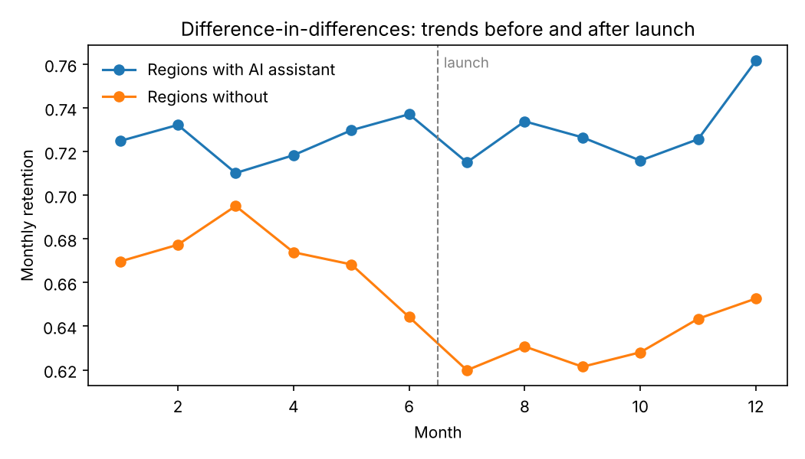
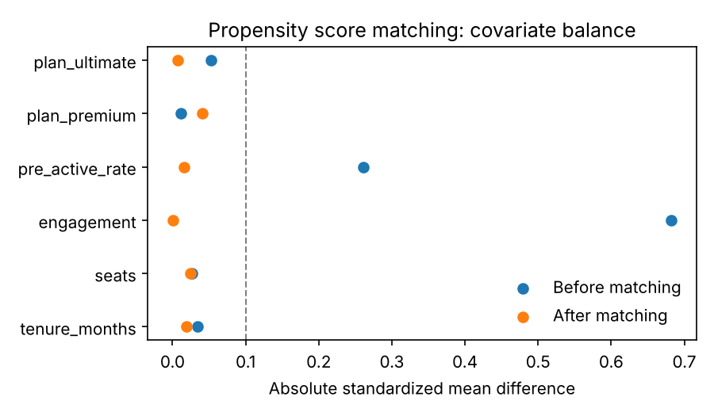
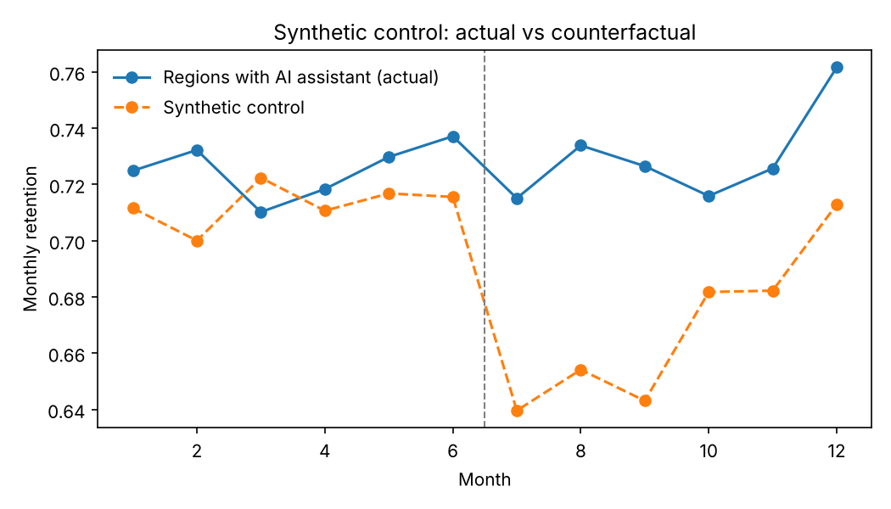

# AI feature causal impact

Did an AI assistant feature improve monthly retention? This project answers that when a clean A/B test was not possible, and compares three quasi-experimental methods against a naive comparison.

The data is synthetic, so the true effect is known (+4.0 percentage points). That makes it possible to see which methods recover it and which ones mislead.

## The setup

- 5,000 accounts across 40 regions, observed for 12 months
- The AI assistant launches in month 7 in 10 regions
- The rollout is **not random**. Regions with more engaged accounts got the feature first, which is how rollouts often work in practice
- Outcome: whether an account was active in a given month

## Results

| Method | Estimate (pp) | 95% CI | Error vs truth (pp) | Notes |
|---|---|---|---|---|
| Naive (treated vs not, after launch) | 9.71 | n/a | +5.71 | Overstates the effect by more than double |
| Difference-in-differences | 4.31 | 2.27 to 6.35 | +0.31 | Region and month fixed effects, errors clustered by region. Pre-trend test p = 0.06 |
| Propensity score matching | 4.50 | 2.95 to 5.76 | +0.50 | All 1,225 treated accounts matched. Max absolute SMD after matching = 0.04 |
| Synthetic control | 6.08 | n/a | +2.08 | Placebo p = 0.45. Pre-launch fit is weaker because treated regions sit at the top of the engagement range |

True effect: **+4.0 pp**.

## What this shows

- **The naive comparison is badly biased.** Treated regions were already more engaged, so comparing them directly mixes the feature's effect with who got it.
- **Difference-in-differences works well here** because treated and control regions moved in parallel before launch. The pre-trend test is borderline (p = 0.06), so in a real analysis I would also run an event-study check before relying on it.
- **Propensity score matching works well** once pre-launch activity is included as a covariate. Balance is good after matching (all SMDs under 0.1).
- **Synthetic control struggles in this setup.** The treated regions are the most engaged, so no weighted mix of less engaged regions can match them closely before launch. The placebo test cannot separate the effect from noise. Synthetic control is a better fit for one or a few treated units that sit inside the range of the donor pool.

## When I would use each method

| Situation | Method |
|---|---|
| Feature rolled out to some groups first, and groups trended together before launch | Difference-in-differences |
| Users chose to adopt, and you have rich data on them from before launch | Propensity score matching |
| One market, region or customer was treated and you have many comparable untreated ones | Synthetic control |

## Charts

| | |
|---|---|
|  |  |
|  | |

## Run it

```bash
pip install -r requirements.txt
python src/simulate.py   # writes data/accounts.csv and data/monthly_activity.csv
python src/analyze.py    # writes outputs/results.csv and charts
```

Results are reproducible with the fixed seeds in the code.

## Files

```
src/simulate.py    synthetic data with a known true effect
src/analyze.py     naive, DiD, PSM and synthetic control estimates
data/              generated CSVs
outputs/           results table, balance table, charts, synthetic control weights
```
